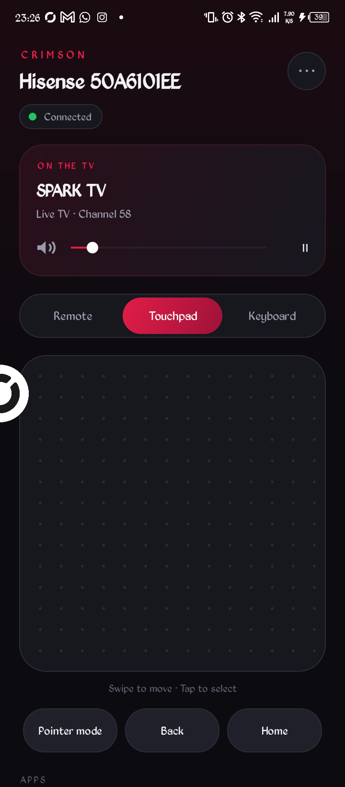
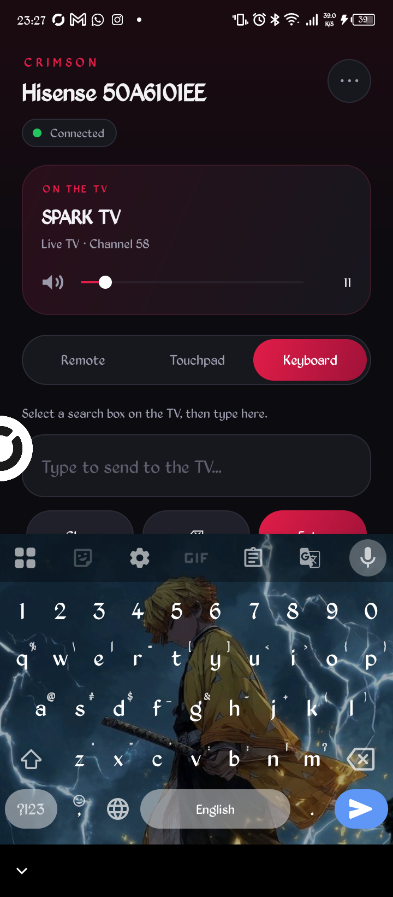

# Crimson Remote

A fast, good-looking Android and iPhone remote for Hisense VIDAA smart TVs, built by **crimson**.

<p>
  
  
  
</p>

## Download & install

**[⬇ Get the latest version](../../releases/latest)** — open the latest release and download the file for your phone.

### Android (`CrimsonRemote.apk`)
1. On the phone, open the latest release and tap **CrimsonRemote.apk**.
2. When asked, allow your browser to **install unknown apps**, then tap **Install**.
3. Open **Crimson Remote**. It finds the TV by itself; type the 4-digit code the TV shows the first time.

### iPhone (`Crimson.ipa`)
iPhone apps outside the App Store are installed with **SideStore** (free, uses your Apple ID).
1. Install SideStore once by following the guide at [sidestore.io](https://sidestore.io).
2. On the iPhone, open the latest release in Safari and download **Crimson.ipa** (it saves to Files).
3. In Files, tap and hold **Crimson.ipa** → **Share** → **SideStore** (or in SideStore tap **+** and pick the file).
4. Open **Crimson**, tap **Allow** when it asks to find devices on your network, then type the TV's 4-digit code.
5. Open SideStore about once a week and tap **Refresh** so the app keeps opening.

### Use it from an iPhone without installing (Android bridge)
In the Android app, turn on **iPhone bridge**. Any phone or laptop on the same Wi-Fi can then open the
link it shows (like `http://192.168.1.10:8787`) and use the remote in the browser.

## Features

- **Finds your TV by itself** on the Wi-Fi network. No accounts, no ads, no tracking.
- **Live "On the TV" card**: the current channel, input or screen, plus a volume slider that stays in sync with the TV.
- **Remote**: power, input picker (with signal indicator), mute, a D-pad, volume and channel rockers, back/home/menu/exit and playback controls. Hold any arrow or volume key to repeat.
- **More buttons**: number pad, red/green/yellow/blue keys, info and subtitles.
- **Touchpad**: swipe to move around the TV, tap to select. *Pointer mode* toggles the TV's on-screen cursor.
- **Keyboard**: type into search boxes on the TV from your phone.
- **App shortcuts** loaded from the TV (YouTube, Netflix, Prime Video and more).
- **Wake the TV** from standby with Wake-on-LAN (add the TV's MAC address in settings).
- Springy press animations, haptic feedback and smooth transitions throughout.

## How it works

VIDAA TVs run a small MQTT broker on port `36669` (TLS). Crimson Remote talks to it
directly with a built-in, dependency-free MQTT 3.1.1 client. The first time you
connect, the TV shows a 4-digit code; type it into the app once to pair.

## Build

No Gradle needed — just the Android build tools and a platform `android.jar` (API 34):

```bash
ANDROID_JAR=/path/to/platforms/android-34/android.jar \
BUILD_TOOLS=/path/to/build-tools/35.0.0 \
./build.sh
```

The signed APK is written to `build/CrimsonRemote.apk`. Install it with
`adb install build/CrimsonRemote.apk`.

## Tested with

Hisense 50A6101EE (VIDAA, firmware V1001.01.00a). Other VIDAA models should work;
keyboard and pointer support may vary by firmware.

## License

MIT © crimson

## Credits

The LG webOS pairing manifest (`lg_manifest.json`) comes from
[aiopylgtv](https://github.com/bendavid/aiopylgtv) by Dennis Karpienski, MIT License.
