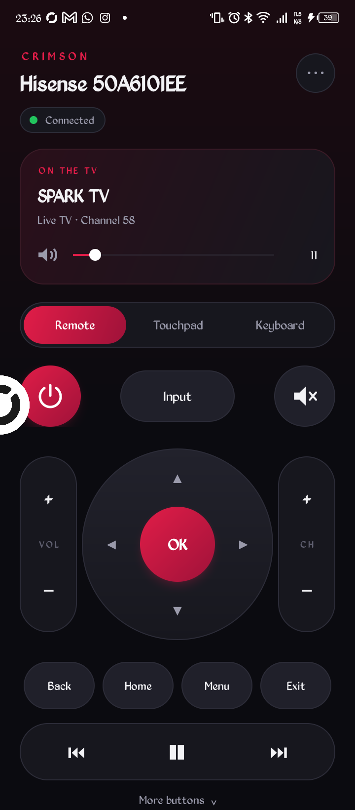

# Crimson Remote

A fast, good-looking Android remote for Hisense VIDAA smart TVs, built by **crimson**.

<p>
  
  
  
</p>

## Features

- **Finds your TV by itself** on the Wi-Fi network. No accounts, no ads, no tracking.
- **Live "On the TV" card**: the current channel, input or screen, plus a volume slider that stays in sync with the TV.
- **Remote**: power, input picker (with signal indicator), mute, a D-pad, volume and channel rockers, back/home/menu/exit and playback controls. Hold any arrow or volume key to repeat.
- **More buttons**: number pad, red/green/yellow/blue keys, info and subtitles.
- **Touchpad**: swipe to move around the TV, tap to select. *Pointer mode* toggles the TV's on-screen cursor.
- **Keyboard**: type into search boxes on the TV from your phone.
- **App shortcuts** loaded from the TV (YouTube, Netflix, Prime Video and more).
- **Wake the TV** from standby with Wake-on-LAN (add the TV's MAC address in settings).
- Springy press animations, haptic feedback and smooth transitions throughout.

## How it works

VIDAA TVs run a small MQTT broker on port `36669` (TLS). Crimson Remote talks to it
directly with a built-in, dependency-free MQTT 3.1.1 client. The first time you
connect, the TV shows a 4-digit code; type it into the app once to pair.

## Build

No Gradle needed — just the Android build tools and a platform `android.jar` (API 34):

```bash
ANDROID_JAR=/path/to/platforms/android-34/android.jar \
BUILD_TOOLS=/path/to/build-tools/35.0.0 \
./build.sh
```

The signed APK is written to `build/CrimsonRemote.apk`. Install it with
`adb install build/CrimsonRemote.apk`.

## Tested with

Hisense 50A6101EE (VIDAA, firmware V1001.01.00a). Other VIDAA models should work;
keyboard and pointer support may vary by firmware.

## License

MIT © crimson
